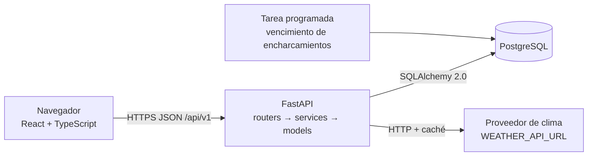
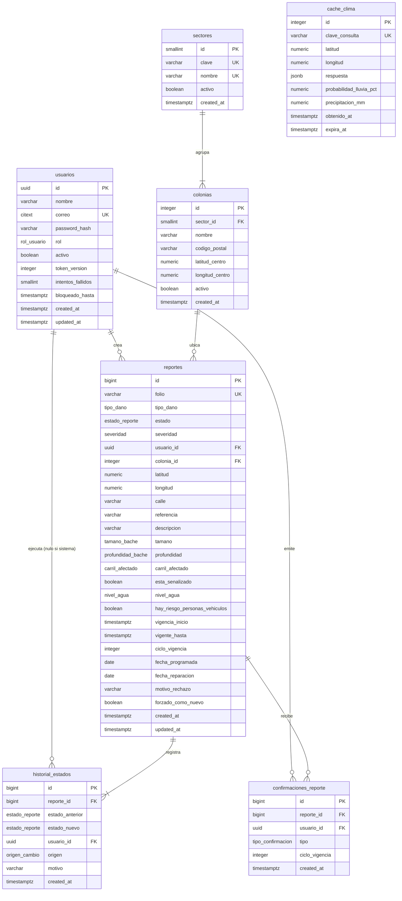
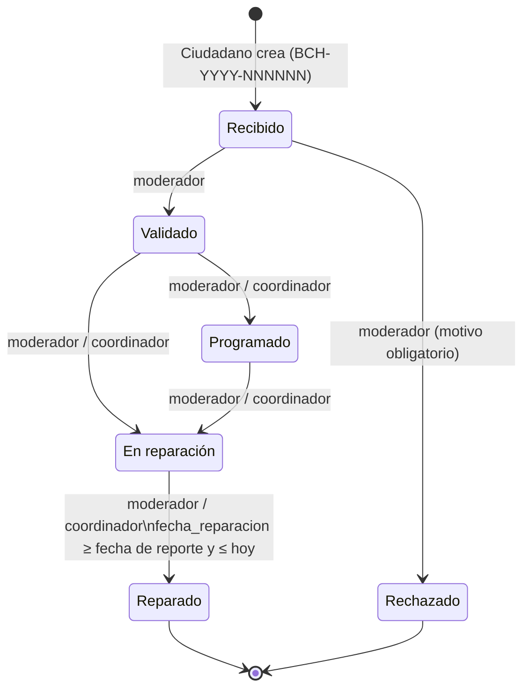
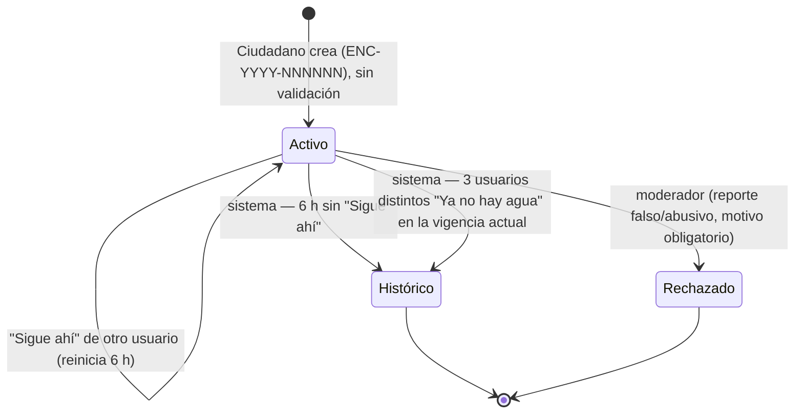

# Arquitectura — Calles Seguras Juárez (AEB-1055)

> Documento de diseño de datos, reglas de negocio y control de acceso.
> Fuente normativa: [`CLAUDE.md`](../CLAUDE.md) (`RN-01` a `RN-10`, `HU-02.2`, `HU-02.3`, `HU-03.1` a `HU-03.3`).
> Contrato HTTP: [`docs/api-contract.md`](./api-contract.md).

---

## 1. Vista general



| Capa | Responsabilidad |
|------|-----------------|
| `routers/` | Declaración de rutas, dependencias de autenticación/rol (`403`), traducción de errores a español. Sin lógica de negocio. |
| `schemas/` | Modelos Pydantic v2 con `extra="forbid"`; esquemas **públicos** y **privados** separados (ver §6). |
| `services/` | Reglas de negocio: territorio, duplicados (Haversine), máquina de estados, vigencia, límite anti-abuso, folios. |
| `models/` | Modelos SQLAlchemy 2.0 (`Mapped[...]`), reflejo 1:1 de este documento. |
| `db/` | Migraciones Alembic (tablas, enums, `CHECK`, índices, triggers) y script `seed`. |

**Defensa en profundidad:** cada regla de negocio crítica se valida en `services/` **y** se respalda en la base de datos con `CHECK`, `UNIQUE`, llaves foráneas o triggers, para que un error de código no pueda violarla.

---

## 2. Diagrama Entidad-Relación



---

## 3. Tipos enumerados (PostgreSQL `ENUM`)

Los valores son **exactamente** los de `CLAUDE.md` y se usan tal cual en la API (JSON) y en la interfaz.

| Enum | Valores |
|------|---------|
| `rol_usuario` | `ciudadano`, `moderador`, `coordinador` *(el `visitante` no se almacena: es la ausencia de token)* |
| `tipo_dano` | `Bache`, `Alcantarilla sin tapa`, `Encharcamiento` |
| `estado_reporte` | `Recibido`, `Validado`, `Programado`, `En reparación`, `Reparado`, `Rechazado`, `Activo`, `Histórico` |
| `severidad` | `Baja`, `Media`, `Alta` |
| `tamano_bache` | `chico`, `mediano`, `grande` |
| `profundidad_bache` | `menos de 5 cm`, `5 a 10 cm`, `más de 10 cm` |
| `carril_afectado` | `carril derecho`, `carril central`, `carril izquierdo`, `varios carriles`, `acotamiento` |
| `nivel_agua` | `a un lado de la calle`, `cubre un carril`, `a media llanta`, `intransitable` |
| `tipo_confirmacion` | `confirmacion_dano` *(baches/alcantarillas: "Yo también lo vi")*, `sigue_ahi` *("Sigue ahí")*, `ya_no_hay_agua` *("Ya no hay agua")* |
| `origen_cambio` | `ciudadano`, `moderacion`, `sistema` |

---

## 4. Diccionario de datos

Convenciones globales:

- Todas las marcas de tiempo son `TIMESTAMPTZ`, almacenadas en **UTC** (`ALTER DATABASE ... SET timezone = 'UTC'`). Ver `RN-02`.
- Coordenadas en `NUMERIC(9,6)` (precisión ≈ 0.11 m).
- Llaves foráneas con `ON DELETE RESTRICT` salvo que se indique lo contrario.
- Extensiones requeridas: `citext` (correo sin distinción de mayúsculas), `pg_trgm` (búsqueda por texto).

### 4.1 `usuarios`

| Columna | Tipo | Nulo | Default | Restricciones / notas |
|---------|------|------|---------|-----------------------|
| `id` | `UUID` | No | `gen_random_uuid()` | PK. UUID para impedir enumeración de cuentas. |
| `nombre` | `VARCHAR(120)` | No | — | `CHECK (char_length(trim(nombre)) >= 2)`. **Dato personal (RN-04).** |
| `correo` | `CITEXT` | No | — | `UNIQUE`. **Dato personal (RN-04).** |
| `password_hash` | `VARCHAR(255)` | No | — | Hash Argon2id. Nunca se serializa en ninguna respuesta. |
| `rol` | `rol_usuario` | No | `'ciudadano'` | Rol único por usuario. El registro público siempre crea `ciudadano`. |
| `activo` | `BOOLEAN` | No | `TRUE` | Cuentas desactivadas reciben `401` al iniciar sesión. |
| `token_version` | `INTEGER` | No | `0` | Se incrementa al cerrar sesión, cambiar rol o desactivar; invalida JWT anteriores (claim `ver`). |
| `intentos_fallidos` | `SMALLINT` | No | `0` | Contador para bloqueo temporal por fuerza bruta. |
| `bloqueado_hasta` | `TIMESTAMPTZ` | Sí | `NULL` | Si `> now()`, el inicio de sesión responde `429`. |
| `created_at` | `TIMESTAMPTZ` | No | `now()` | |
| `updated_at` | `TIMESTAMPTZ` | No | `now()` | Actualizado por trigger. |

Índices: `UNIQUE (correo)`; `idx_usuarios_rol (rol)`.

### 4.2 `sectores`

| Columna | Tipo | Nulo | Default | Restricciones / notas |
|---------|------|------|---------|-----------------------|
| `id` | `SMALLINT` | No | identity | PK. |
| `clave` | `VARCHAR(20)` | No | — | `UNIQUE`, `CHECK (clave ~ '^[A-Z0-9-]{2,20}$')`. Ej.: `SUR-ORIENTE`. |
| `nombre` | `VARCHAR(80)` | No | — | `UNIQUE`. Ej.: `Suroriente`. |
| `activo` | `BOOLEAN` | No | `TRUE` | Los catálogos no se borran; se desactivan. |
| `created_at` | `TIMESTAMPTZ` | No | `now()` | |

### 4.3 `colonias`

| Columna | Tipo | Nulo | Default | Restricciones / notas |
|---------|------|------|---------|-----------------------|
| `id` | `INTEGER` | No | identity | PK. |
| `sector_id` | `SMALLINT` | No | — | FK → `sectores.id`. |
| `nombre` | `VARCHAR(120)` | No | — | `UNIQUE (sector_id, nombre)`. |
| `codigo_postal` | `VARCHAR(5)` | Sí | — | `CHECK (codigo_postal ~ '^32[0-9]{3}$')` (CP de Juárez inician en 32). |
| `latitud_centro` | `NUMERIC(9,6)` | No | — | `CHECK (latitud_centro BETWEEN 31.45 AND 31.80)` — **RN-01**. |
| `longitud_centro` | `NUMERIC(9,6)` | No | — | `CHECK (longitud_centro BETWEEN -106.65 AND -106.25)` — **RN-01**. |
| `activo` | `BOOLEAN` | No | `TRUE` | |
| `created_at` | `TIMESTAMPTZ` | No | `now()` | |

Índices: `idx_colonias_sector (sector_id)`; `idx_colonias_nombre_trgm GIN (nombre gin_trgm_ops)` para autocompletado.

### 4.4 `reportes`

Tabla única para los tres tipos de daño (herencia de tabla única). Los campos específicos son nulables y su obligatoriedad se garantiza con `CHECK` por `tipo_dano`. Esto simplifica la búsqueda de duplicados, las métricas y la consulta pública.

| Columna | Tipo | Nulo | Default | Restricciones / notas |
|---------|------|------|---------|-----------------------|
| `id` | `BIGINT` | No | identity | PK interna. **No se expone en la API**; el identificador público es `folio`. |
| `folio` | `VARCHAR(15)` | No | Generado por servidor | `UNIQUE`. Formato `BCH-YYYY-NNNNNN` o `ENC-YYYY-NNNNNN`. Inmutable (trigger). **RN-03**. |
| `tipo_dano` | `tipo_dano` | No | — | Inmutable (trigger). |
| `estado` | `estado_reporte` | No | — | `Recibido` para pavimento; `Activo` para encharcamiento. |
| `severidad` | `severidad` | No | — | Calculada por backend (§5.4). Nunca la envía el cliente. |
| `usuario_id` | `UUID` | No | — | FK → `usuarios.id`. Autor. **Nunca se expone públicamente (RN-04).** |
| `colonia_id` | `INTEGER` | No | — | FK → `colonias.id`. |
| `latitud` | `NUMERIC(9,6)` | No | — | `CHECK (latitud BETWEEN 31.45 AND 31.80)` — **RN-01**. |
| `longitud` | `NUMERIC(9,6)` | No | — | `CHECK (longitud BETWEEN -106.65 AND -106.25)` — **RN-01**. |
| `calle` | `VARCHAR(150)` | No | — | Calle principal; base de la consulta de "calles con riesgo". |
| `referencia` | `VARCHAR(200)` | Sí | — | Entre calles / punto de referencia. |
| `descripcion` | `VARCHAR(500)` | Sí | — | `CHECK (char_length(descripcion) <= 500)`. |
| `tamano` | `tamano_bache` | Sí | — | Obligatorio si `tipo_dano = 'Bache'` (**HU-02.2**). |
| `profundidad` | `profundidad_bache` | Sí | — | Obligatorio si `tipo_dano = 'Bache'`. |
| `carril_afectado` | `carril_afectado` | Sí | — | Obligatorio si `tipo_dano = 'Bache'`. |
| `esta_senalizado` | `BOOLEAN` | Sí | — | Obligatorio si `tipo_dano = 'Alcantarilla sin tapa'`. |
| `nivel_agua` | `nivel_agua` | Sí | — | Obligatorio si `tipo_dano = 'Encharcamiento'` (**HU-03.1**). |
| `hay_riesgo_personas_vehiculos` | `BOOLEAN` | Sí | — | Obligatorio **sólo** si `nivel_agua = 'intransitable'`. |
| `vigencia_inicio` | `TIMESTAMPTZ` | Sí | — | Inicio de la vigencia actual (creación o último "Sigue ahí"). Sólo encharcamientos. |
| `vigente_hasta` | `TIMESTAMPTZ` | Sí | — | `vigencia_inicio + 6 h`. Sólo encharcamientos. **RN-06**. |
| `ciclo_vigencia` | `INTEGER` | No | `0` | Se incrementa con cada "Sigue ahí"; delimita la "vigencia actual". |
| `fecha_programada` | `DATE` | Sí | — | Fecha local estimada de reparación (estado `Programado`). |
| `fecha_reparacion` | `DATE` | Sí | — | Fecha local (`America/Ciudad_Juarez`) de reparación. **RN-05 / RN-10**. |
| `motivo_rechazo` | `VARCHAR(500)` | Sí | — | Obligatorio si `estado = 'Rechazado'`. **RN-07**. |
| `forzado_como_nuevo` | `BOOLEAN` | No | `FALSE` | `TRUE` si el ciudadano ignoró duplicados cercanos (auditoría de **HU-02.3**). |
| `created_at` | `TIMESTAMPTZ` | No | `now()` | **Inmutable para todos los roles** (trigger). **RN-10**. |
| `updated_at` | `TIMESTAMPTZ` | No | `now()` | |

**Restricciones `CHECK` de tabla:**

```sql
-- Campos específicos por tipo (HU-02.2 / HU-03.1)
CONSTRAINT ck_campos_bache CHECK (
  tipo_dano <> 'Bache' OR (tamano IS NOT NULL AND profundidad IS NOT NULL AND carril_afectado IS NOT NULL
                           AND esta_senalizado IS NULL AND nivel_agua IS NULL AND hay_riesgo_personas_vehiculos IS NULL)),
CONSTRAINT ck_campos_alcantarilla CHECK (
  tipo_dano <> 'Alcantarilla sin tapa' OR (esta_senalizado IS NOT NULL AND severidad = 'Alta'
                           AND tamano IS NULL AND profundidad IS NULL AND carril_afectado IS NULL
                           AND nivel_agua IS NULL AND hay_riesgo_personas_vehiculos IS NULL)),
CONSTRAINT ck_campos_encharcamiento CHECK (
  tipo_dano <> 'Encharcamiento' OR (nivel_agua IS NOT NULL
                           AND (nivel_agua = 'intransitable') = (hay_riesgo_personas_vehiculos IS NOT NULL)
                           AND vigencia_inicio IS NOT NULL AND vigente_hasta IS NOT NULL
                           AND tamano IS NULL AND profundidad IS NULL AND carril_afectado IS NULL AND esta_senalizado IS NULL)),

-- Estados válidos por familia (RN-05 / RN-06)
CONSTRAINT ck_estado_por_tipo CHECK (
  (tipo_dano IN ('Bache','Alcantarilla sin tapa') AND estado IN ('Recibido','Validado','Programado','En reparación','Reparado','Rechazado'))
  OR (tipo_dano = 'Encharcamiento' AND estado IN ('Activo','Histórico','Rechazado'))),

-- Folio coherente con el tipo (RN-03)
CONSTRAINT ck_folio_formato CHECK (
  (tipo_dano IN ('Bache','Alcantarilla sin tapa') AND folio ~ '^BCH-[0-9]{4}-[0-9]{6}$')
  OR (tipo_dano = 'Encharcamiento' AND folio ~ '^ENC-[0-9]{4}-[0-9]{6}$')),

-- Reparación (RN-05 / RN-10)
CONSTRAINT ck_reparado_con_fecha CHECK ((estado = 'Reparado') = (fecha_reparacion IS NOT NULL)),
CONSTRAINT ck_fecha_reparacion_posterior CHECK (
  fecha_reparacion IS NULL OR fecha_reparacion >= (created_at AT TIME ZONE 'America/Ciudad_Juarez')::date),

-- Rechazo con motivo (RN-07)
CONSTRAINT ck_rechazo_con_motivo CHECK (
  estado <> 'Rechazado' OR (motivo_rechazo IS NOT NULL AND char_length(trim(motivo_rechazo)) >= 10)),

-- Vigencia de 6 h (RN-06)
CONSTRAINT ck_vigencia_6h CHECK (vigente_hasta IS NULL OR vigente_hasta = vigencia_inicio + INTERVAL '6 hours')
```

**Índices:**

| Índice | Definición | Propósito |
|--------|------------|-----------|
| `uq_reportes_folio` | `UNIQUE (folio)` | RN-03. |
| `idx_reportes_pav_abiertos_coord` | `BTREE (tipo_dano, latitud, longitud) WHERE estado IN ('Recibido','Validado','Programado','En reparación')` | Prefiltro por caja envolvente para duplicados a ≤ 30 m (HU-02.3). |
| `idx_reportes_enc_activos_coord` | `BTREE (latitud, longitud) WHERE tipo_dano = 'Encharcamiento' AND estado = 'Activo'` | Prefiltro para duplicados a ≤ 50 m (HU-03.1) y mapa de vigentes. |
| `idx_reportes_enc_vencimiento` | `BTREE (vigente_hasta) WHERE estado = 'Activo'` | Tarea de vencimiento (RN-06). |
| `idx_reportes_usuario_created` | `BTREE (usuario_id, created_at DESC)` | Límite de 10 reportes/hora (RN-08) y "Mis reportes". |
| `idx_reportes_estado_created` | `BTREE (estado, created_at DESC)` | Cola de moderación y listados públicos. |
| `idx_reportes_colonia` | `BTREE (colonia_id)` | Filtros e indicadores por colonia/sector. |
| `idx_reportes_calle_trgm` | `GIN (calle gin_trgm_ops)` | Búsqueda de calles con riesgo de inundación. |

**Triggers:**

| Trigger | Momento | Efecto |
|---------|---------|--------|
| `trg_reportes_inmutables` | `BEFORE UPDATE` | Lanza excepción si cambian `folio`, `tipo_dano`, `usuario_id`, `created_at`, `latitud`, `longitud`. RN-03, RN-10. |
| `trg_reportes_transicion` | `BEFORE UPDATE OF estado` | Valida el par (`OLD.estado`, `NEW.estado`) contra la tabla de transiciones (§7) y `fecha_reparacion <= fecha local actual`. Respaldo de RN-05. |
| `trg_reportes_historial` | `AFTER INSERT OR UPDATE OF estado` | Inserta en `historial_estados` con `usuario_id`, `origen` y `motivo` leídos de `current_setting('app.usuario_id' / 'app.origen' / 'app.motivo')` fijados con `SET LOCAL` por el servicio. Garantiza que **ningún** cambio de estado quede sin registrar. RN-07. |
| `trg_reportes_sin_borrado` | `BEFORE DELETE` | Lanza excepción siempre. RN-07 (ver §5.7). |

### 4.5 `historial_estados`

Bitácora **append-only**.

| Columna | Tipo | Nulo | Default | Restricciones / notas |
|---------|------|------|---------|-----------------------|
| `id` | `BIGINT` | No | identity | PK. |
| `reporte_id` | `BIGINT` | No | — | FK → `reportes.id` `ON DELETE RESTRICT`. |
| `estado_anterior` | `estado_reporte` | Sí | — | `NULL` en el registro de creación. |
| `estado_nuevo` | `estado_reporte` | No | — | `CHECK (estado_anterior IS DISTINCT FROM estado_nuevo)`. |
| `usuario_id` | `UUID` | Sí | — | FK → `usuarios.id`. `NULL` sólo si `origen = 'sistema'`. **No se expone públicamente.** |
| `origen` | `origen_cambio` | No | — | `CHECK ((origen = 'sistema') = (usuario_id IS NULL))`. |
| `motivo` | `VARCHAR(500)` | Sí | — | Obligatorio cuando `estado_nuevo = 'Rechazado'` (`CHECK`). |
| `created_at` | `TIMESTAMPTZ` | No | `now()` | Para vencimientos automáticos se registra el instante real de vencimiento (`vigente_hasta`), no la hora en que corrió la tarea. |

Índices: `idx_historial_reporte (reporte_id, created_at)`.

Inmutabilidad: trigger `trg_historial_append_only` (`BEFORE UPDATE OR DELETE` → excepción) **y** `REVOKE UPDATE, DELETE, TRUNCATE ON historial_estados FROM <rol_app>`.

### 4.6 `confirmaciones_reporte`

| Columna | Tipo | Nulo | Default | Restricciones / notas |
|---------|------|------|---------|-----------------------|
| `id` | `BIGINT` | No | identity | PK. |
| `reporte_id` | `BIGINT` | No | — | FK → `reportes.id`. |
| `usuario_id` | `UUID` | No | — | FK → `usuarios.id`. **No se expone públicamente.** |
| `tipo` | `tipo_confirmacion` | No | — | `confirmacion_dano` sólo para pavimento; `sigue_ahi` / `ya_no_hay_agua` sólo para encharcamiento (trigger). |
| `ciclo_vigencia` | `INTEGER` | No | — | Copia de `reportes.ciclo_vigencia` al momento de confirmar (siempre `0` en pavimento). |
| `created_at` | `TIMESTAMPTZ` | No | `now()` | |

Restricciones:

- `UNIQUE (reporte_id, usuario_id, ciclo_vigencia)` → **una confirmación por usuario** por reporte de pavimento y por vigencia en encharcamientos.
- Trigger `trg_confirmacion_valida` (`BEFORE INSERT`): rechaza si `NEW.usuario_id = reportes.usuario_id` (el autor no confirma ni desmiente su propio reporte), si el reporte no está abierto/`Activo`, o si el `tipo` no corresponde al `tipo_dano`.
- Append-only (mismo esquema de trigger + `REVOKE` que el historial).

Índices: `idx_confirmaciones_reporte_ciclo (reporte_id, ciclo_vigencia, tipo)` para contar "Ya no hay agua" de la vigencia actual.

### 4.7 `cache_clima`

| Columna | Tipo | Nulo | Default | Restricciones / notas |
|---------|------|------|---------|-----------------------|
| `id` | `INTEGER` | No | identity | PK. |
| `clave_consulta` | `VARCHAR(60)` | No | — | `UNIQUE`. Ej.: `pronostico:juarez`. |
| `latitud` | `NUMERIC(9,6)` | No | — | Dentro de RN-01. |
| `longitud` | `NUMERIC(9,6)` | No | — | Dentro de RN-01. |
| `respuesta` | `JSONB` | No | — | Respuesta normalizada del proveedor (sin encabezados ni llaves de API). |
| `probabilidad_lluvia_pct` | `NUMERIC(5,2)` | Sí | — | `CHECK (BETWEEN 0 AND 100)`. |
| `precipitacion_mm` | `NUMERIC(6,2)` | Sí | — | `CHECK (>= 0)`. |
| `obtenido_at` | `TIMESTAMPTZ` | No | `now()` | |
| `expira_at` | `TIMESTAMPTZ` | No | — | `obtenido_at + WEATHER_CACHE_TTL_MINUTES`. `CHECK (expira_at > obtenido_at)`. |

Estrategia: *upsert* por `clave_consulta`. Si el proveedor falla y existe caché vencida, se sirve marcada como `desactualizado: true`; si no hay caché, `503`.

### 4.8 `reporte_fotos` (HU-02.4)

| Columna | Tipo | Nulo | Default | Restricciones / notas |
|---------|------|------|---------|-----------------------|
| `id` | `UUID` | No | `gen_random_uuid()` | PK; es el `foto_id` público. |
| `reporte_id` | `BIGINT` | No | — | FK → `reportes.id` (`RESTRICT`). |
| `usuario_id` | `UUID` | No | — | FK → `usuarios.id`. Nunca se expone (RN-04). |
| `ruta_almacenamiento` | `VARCHAR(80)` | No | — | `UNIQUE`. Nombre de archivo `UUIDv4` + `.jpg`/`.png`; no se deriva del nombre original. |
| `nombre_original` | `VARCHAR(150)` | No | — | Sólo se muestra como texto; se sanea (sin rutas ni `<>"`). |
| `mime_type` | `VARCHAR(20)` | No | — | `CHECK IN ('image/jpeg','image/png')`; se detecta por *magic bytes*, no por el cliente. |
| `tamano_bytes` | `INTEGER` | No | — | `CHECK (> 0 AND <= 5242880)` (5 MB). |
| `created_at` | `TIMESTAMPTZ` | No | `now()` | Inmutable (RN-10): el trigger `trg_reporte_fotos_inmutable` rechaza todo `UPDATE`. |

Límite: **3 fotos por persona y reporte** (se valida con candado de fila `SELECT … FOR UPDATE` para que dos solicitudes simultáneas no lo superen). Sólo suben fotos quien creó el reporte o quien lo confirmó (HU-02.3). Los archivos viven en `UPLOADS_DIR` (volumen `uploads` en Docker); **nunca** se sirven como estáticos.

**Acceso a la imagen** (`GET /api/v1/reportes/{folio}/fotos/{foto_id}`): mientras el reporte esté `Recibido`, sólo lo ven su autor, moderación y coordinación (`403` para visitantes y otros ciudadanos). Al pasar a `Validado` (o cualquier estado posterior público) la foto es pública. Un reporte `Rechazado` responde `404` a quien no sea su autor o moderación (RN-09).

### 4.9 `notificaciones` (HU-08.2)

| Columna | Tipo | Nulo | Default | Restricciones / notas |
|---------|------|------|---------|-----------------------|
| `id` | `UUID` | No | `gen_random_uuid()` | PK (no enumerable). |
| `usuario_id` | `UUID` | No | — | FK → `usuarios.id`. Dueño del aviso: la API filtra siempre por esta columna. |
| `reporte_id` | `BIGINT` | No | — | FK → `reportes.id` (`RESTRICT`). |
| `folio` | `VARCHAR(15)` | No | — | Folio público para navegar a `/reportes/:folio`. |
| `mensaje` | `VARCHAR(800)` | No | — | Texto en español de México; no contiene datos de terceros. |
| `leida` | `BOOLEAN` | No | `false` | |
| `created_at` | `TIMESTAMPTZ` | No | `now()` | |

Índice: `idx_notificaciones_usuario (usuario_id, leida, created_at DESC)`. Se crea una fila en la **misma transacción** que el cambio de estado hecho por moderación (si la transacción falla, no hay aviso). Quien hace el cambio no se notifica a sí mismo. Además, `reportes.idempotency_key UUID` (HU-08.4) con índice único parcial `uq_reportes_idempotencia (usuario_id, idempotency_key)`; nunca se expone en la API.

---

## 5. Cómo el esquema garantiza las reglas de negocio

| Regla | Servicio (`services/`) | Base de datos |
|-------|------------------------|---------------|
| **RN-01 Territorio** | Validador Pydantic de `latitud`/`longitud` → `422` con mensaje *"La ubicación está fuera de los límites de Ciudad Juárez, Chihuahua."* | `CHECK` de rango en `reportes`, `colonias` y `cache_clima`. |
| **RN-02 Hora oficial** | Toda serialización convierte a `ZoneInfo("America/Ciudad_Juarez")` (offset `-07:00` invierno / `-06:00` verano). Cálculos de "hoy", longevidad y fecha de reparación usan la fecha **local**. | `TIMESTAMPTZ` + sesión en `UTC`. `ck_fecha_reparacion_posterior` compara en zona local. La imagen Docker debe incluir `tzdata ≥ 2022g` (la zona `America/Ciudad_Juarez` se creó en esa versión). |
| **RN-03 Folios** | Generados sólo por el servidor; el cliente no puede enviarlos (`extra="forbid"`). | Dos secuencias independientes `seq_folio_bch` y `seq_folio_enc` (`NO CYCLE`). Las secuencias de PostgreSQL **nunca devuelven un valor dos veces**, aun con *rollback*, por lo que los folios no se reutilizan (puede haber huecos, lo cual es aceptable). `YYYY` = año local de `created_at`; `NNNNNN` = `lpad(nextval, 6, '0')`. `UNIQUE (folio)` + `ck_folio_formato` + trigger de inmutabilidad. |
| **RN-04 Privacidad** | Esquemas `*Publico` sin campos de identidad (§6 y `api-contract.md` §9). | Datos personales sólo en `usuarios`; `reportes` y `confirmaciones` guardan únicamente `usuario_id` (UUID), que nunca se serializa en vistas públicas. |
| **RN-05 Máquina de estados** | `services/transiciones.py` con tabla de transiciones + rol permitido; transición inválida → `400 TRANSICION_INVALIDA`, rol no autorizado → `403`. | `trg_reportes_transicion` + `ck_estado_por_tipo` + `ck_reparado_con_fecha` + `ck_fecha_reparacion_posterior`. |
| **RN-06 Vigencia** | Ver §5.5. | `vigencia_inicio`, `vigente_hasta`, `ciclo_vigencia`, `ck_vigencia_6h`, `UNIQUE` por ciclo, `idx_reportes_enc_vencimiento`. |
| **RN-07 Trazabilidad** | No existe endpoint `DELETE` de reportes (la ruta responde `405`). Rechazo exige `motivo` (≥ 10 caracteres). | `trg_reportes_sin_borrado`, `ck_rechazo_con_motivo`, `trg_reportes_historial`, `historial_estados` append-only + `REVOKE`. |
| **RN-08 Anti-abuso** | En la misma transacción: `pg_advisory_xact_lock(hashtext(usuario_id))` → `SELECT count(*) FROM reportes WHERE usuario_id = :u AND created_at > now() - INTERVAL '1 hour'`; si `>= 10` → `429` con encabezado `Retry-After`. El candado evita que solicitudes concurrentes superen el límite. Aplica a **todas** las cuentas (cualquier rol). | `idx_reportes_usuario_created`. |
| **RN-09 Visibilidad** | Consultas públicas siempre filtran `estado <> 'Rechazado'`; el esquema público agrega `etiqueta_publica = 'Sin validar'` cuando `estado = 'Recibido'`. Un folio `Rechazado` consultado públicamente responde `404` (no se revela su existencia). | `idx_reportes_estado_created`. |
| **RN-10 Longevidad** | `longevidad_dias = (fecha_reparacion − fecha_local(created_at))` si `Reparado`; si sigue abierto, `(hoy_local − fecha_local(created_at))`. Para `Rechazado` y encharcamientos es `null`. | `trg_reportes_inmutables` impide modificar `created_at` a cualquier rol, incluido `coordinador`. |

### 5.1 Campos específicos por tipo de daño (HU-02.2 / HU-03.1)

| `tipo_dano` | Campos obligatorios | Campos prohibidos | Regla automática |
|-------------|---------------------|-------------------|------------------|
| `Bache` | `tamano`, `profundidad`, `carril_afectado` | `esta_senalizado`, `nivel_agua`, `hay_riesgo_personas_vehiculos` | `severidad` calculada (§5.4). |
| `Alcantarilla sin tapa` | `esta_senalizado` | `tamano`, `profundidad`, `carril_afectado`, `nivel_agua`, `hay_riesgo_personas_vehiculos` | `severidad = 'Alta'` fijada en backend. |
| `Encharcamiento` | `nivel_agua`; `hay_riesgo_personas_vehiculos` **sólo** si `nivel_agua = 'intransitable'` | `tamano`, `profundidad`, `carril_afectado`, `esta_senalizado` | `estado = 'Activo'`, `vigencia_inicio = now()`, `vigente_hasta = now() + 6 h`. |

Implementación en Pydantic: unión discriminada por `tipo_dano` (`Annotated[Union[...], Field(discriminator="tipo_dano")]`) con `extra="forbid"` y `model_validator` para la condición de `intransitable`. `descripcion: str | None = Field(default=None, max_length=500)`.

### 5.2 Duplicados (HU-02.3 / HU-03.1)

1. Prefiltro por caja envolvente con los índices parciales (Juárez ≈ 31.7° N):
   - 30 m → Δlat ≈ `0.00027°`, Δlon ≈ `0.00032°`.
   - 50 m → Δlat ≈ `0.00045°`, Δlon ≈ `0.00053°`.
2. Filtro exacto con la función SQL `IMMUTABLE` `distancia_haversine_m(lat1, lon1, lat2, lon2)` (radio terrestre 6 371 008.8 m), creada en la migración.
3. Candidatos:
   - Pavimento: mismo `tipo_dano`, `estado IN ('Recibido','Validado','Programado','En reparación')`, distancia ≤ 30 m.
   - Encharcamiento: `estado = 'Activo' AND vigente_hasta > now()`, distancia ≤ 50 m.
4. Si hay candidatos y `forzar_nuevo = false` → `409 POSIBLE_DUPLICADO` con la lista (esquema público). El ciudadano puede **confirmar el existente** (`POST /reportes/{folio}/confirmaciones`, 1 por usuario) o reenviar con `forzar_nuevo = true` (se guarda `forzado_como_nuevo = TRUE`).

### 5.3 Confirmaciones

- Pavimento: `tipo = 'confirmacion_dano'`, `ciclo_vigencia = 0` ⇒ `UNIQUE` garantiza una por usuario.
- Encharcamiento: `sigue_ahi` o `ya_no_hay_agua`, una por usuario **por vigencia** (no puede marcar ambas en la misma vigencia).
- El autor nunca puede confirmar ni desmentir su propio reporte (servicio → `400 AUTOCONFIRMACION_NO_PERMITIDA`; trigger como respaldo).

### 5.4 Severidad de baches (calculada en backend)

| Condición (se evalúa en orden) | `severidad` |
|--------------------------------|-------------|
| `tamano = 'grande'` **o** `profundidad = 'más de 10 cm'` | `Alta` |
| `tamano = 'mediano'` **o** `profundidad = '5 a 10 cm'` | `Media` |
| En otro caso | `Baja` |
| `tipo_dano = 'Alcantarilla sin tapa'` | `Alta` (siempre) |
| `tipo_dano = 'Encharcamiento'` | `intransitable` → `Alta`; `a media llanta` → `Media`; resto → `Baja` |

### 5.5 Vigencia automática de encharcamientos (RN-06, HU-03.2, HU-03.3)

```text
Creación:        estado='Activo', ciclo_vigencia=0, vigencia_inicio=now(), vigente_hasta=now()+6h

"Sigue ahí"      (SELECT ... FOR UPDATE sobre el reporte)
  de otro usuario  → ciclo_vigencia += 1
                   → vigencia_inicio = now(), vigente_hasta = now() + 6h
                   → insertar confirmación con el NUEVO ciclo_vigencia
                   (los "Ya no hay agua" del ciclo anterior dejan de contar)

"Ya no hay agua" (SELECT ... FOR UPDATE)
  de otro usuario  → insertar confirmación con ciclo_vigencia actual
                   → si count(DISTINCT usuario_id) del ciclo actual >= 3:
                       estado='Histórico' (origen='sistema', motivo='3 usuarios reportaron que ya no hay agua')

Vencimiento      Tarea cada 5 min (APScheduler en el backend):
                   UPDATE ... SET estado='Histórico' WHERE estado='Activo' AND vigente_hasta <= now()
                   historial.created_at = vigente_hasta, origen='sistema',
                   motivo='Sin confirmaciones durante 6 horas'
```

**Consistencia entre ejecuciones de la tarea:** toda consulta pública de vigentes filtra `estado = 'Activo' AND vigente_hasta > now()`, de modo que un encharcamiento vencido nunca se muestra como vigente aunque la tarea aún no haya corrido. El candado `FOR UPDATE` evita condiciones de carrera entre confirmaciones simultáneas.

Los encharcamientos `Histórico` **siguen contando en métricas** e indicadores de riesgo por calle/colonia.

### 5.6 Historial inmutable

- Toda transición pasa por `trg_reportes_historial`; el servicio no puede "olvidar" registrarla.
- `historial_estados` y `confirmaciones_reporte` son *append-only* a nivel trigger **y** a nivel permisos del rol de aplicación.
- El registro de creación (`estado_anterior = NULL`) se escribe en la misma transacción que el `INSERT` del reporte.

### 5.7 Eliminación de reportes

`RN-07` prohíbe eliminar reportes que salieron de `Recibido`. Por simplicidad y mayor trazabilidad, **la versión 1 no permite eliminar ningún reporte**: no existe endpoint `DELETE` y `trg_reportes_sin_borrado` bloquea la operación en la base. Un reporte improcedente se lleva a `Rechazado` con motivo.

---

## 6. Separación de esquemas público / privado (RN-04)

| Esquema | Audiencia | Incluye identidad del autor |
|---------|-----------|-----------------------------|
| `ReportePublico`, `ReporteResumenPublico`, `HistorialPublico`, `IndicadorPublico`, `RiesgoCalle` | Cualquiera (sin token) | **No** |
| `MiReporte` | El propio autor | No incluye nombre/correo (ya los conoce); sólo `es_mio: true`. Incluye `motivo_rechazo` de sus propios reportes rechazados. |
| `ReporteModeracion`, `HistorialModeracion` | `moderador`, `coordinador` | Sólo `autor_id` (UUID) y `reportes_autor_ultimas_24h`, para detectar abuso. **Nunca** nombre ni correo. |
| `UsuarioAdmin` | `coordinador` | Sí (`nombre`, `correo`) — vista privada de administración, nunca vinculada a reportes en la misma respuesta. |

Campos **prohibidos** en cualquier respuesta pública: `usuario_id`, `autor_id`, `nombre`, `correo`, `password_hash`, `token_version`, `ip`, `motivo_rechazo` (los rechazados no son públicos). Se verifica con una prueba automatizada que recorre todas las rutas públicas (ver `api-contract.md` §9).

> **Nota:** `descripcion` es texto libre escrito por el ciudadano. El formulario debe advertir *"No escribas datos personales en la descripción"* y el moderador puede rechazar reportes que los contengan.

---

## 7. Máquina de estados

### 7.1 Baches y alcantarillas (`RN-05`)



| Desde | Hacia | Roles permitidos | Requisitos |
|-------|-------|------------------|------------|
| `Recibido` | `Validado` | `moderador` | — |
| `Recibido` | `Rechazado` | `moderador` | `motivo` ≥ 10 caracteres |
| `Validado` | `Programado` | `moderador`, `coordinador` | `fecha_programada` opcional (≥ hoy local) |
| `Validado` | `En reparación` | `moderador`, `coordinador` | — |
| `Programado` | `En reparación` | `moderador`, `coordinador` | — |
| `En reparación` | `Reparado` | `moderador`, `coordinador` | `fecha_reparacion` ≥ fecha local de `created_at` y ≤ hoy local |
| `Reparado`, `Rechazado` | *(cualquiera)* | — | Estados finales → `400 TRANSICION_INVALIDA` |

Cualquier par no listado → `400 TRANSICION_INVALIDA`. Par válido pero rol no autorizado (p. ej. `coordinador` intentando `Recibido → Validado`) → `403 ROL_NO_AUTORIZADO`. Datos faltantes o fuera de rango (fecha) → `422`.

### 7.2 Encharcamientos (`RN-06`)



> La transición `Activo → Rechazado` no está descrita explícitamente en `CLAUDE.md`; se incluye para que la moderación pueda retirar reportes falsos de la vista pública sin violar `RN-07` (no se elimina, se rechaza con motivo). `Histórico` y `Rechazado` son finales.

---

## 8. Matriz de control de acceso

Los roles **no son estrictamente jerárquicos** (p. ej. `coordinador` no valida reportes). La autorización se aplica en FastAPI con dependencias `requiere_rol(...)`; un rol sin permiso recibe `403`, y la ausencia/expiración de token, `401`.

| Acción | `visitante` | `ciudadano` | `moderador` | `coordinador` |
|--------|:-----------:|:-----------:|:-----------:|:-------------:|
| Registrarse / iniciar sesión | ✅ | — | — | — |
| Ver mapa y lista pública de reportes (sin `Rechazado`, `Recibido` como "Sin validar") | ✅ | ✅ | ✅ | ✅ |
| Ver detalle e historial público de un folio | ✅ | ✅ | ✅ | ✅ |
| Consultar catálogos (sectores, colonias, tipos de daño, estados) | ✅ | ✅ | ✅ | ✅ |
| Consultar clima y calles con riesgo de inundación | ✅ | ✅ | ✅ | ✅ |
| Ver indicadores públicos | ✅ | ✅ | ✅ | ✅ |
| Crear reporte (máx. 10/hora, RN-08) | ❌ 401 | ✅ | ✅ | ✅ |
| Buscar duplicados cercanos | ❌ 401 | ✅ | ✅ | ✅ |
| Confirmar / "Sigue ahí" / "Ya no hay agua" (no sobre reporte propio) | ❌ 401 | ✅ | ✅ | ✅ |
| Ver "Mis reportes" | ❌ 401 | ✅ | ✅ | ✅ |
| Adjuntar hasta 3 fotos JPG/PNG (autor o quien confirmó el reporte) | ❌ 401 | ✅ | ✅ | ✅ |
| Ver fotos de un reporte `Recibido` (autor, moderación y coordinación) | ❌ 403 | ❌ 403 (salvo autor) | ✅ | ✅ |
| Mapa interactivo (`/reportes/mapa`) | ✅ | ✅ | ✅ | ✅ |
| Exportar reportes a CSV / XML | ❌ 401 | ❌ 403 | ✅ | ✅ |
| Importar catálogos desde XML | ❌ 401 | ❌ 403 | ❌ 403 | ✅ |
| Ver y marcar **mis** avisos (`/notificaciones`) | ❌ 401 | ✅ | ✅ | ✅ |
| Leer avisos de otra persona | ❌ 401 | ❌ 404 | ❌ 404 | ❌ 404 |
| Canal WebSocket de encharcamientos en vivo (datos públicos) | ✅ | ✅ | ✅ | ✅ |
| Ver puntos recurrentes de inundación (`/indicadores/puntos-recurrentes`) | ❌ 401 | ❌ 403 | ❌ 403 | ✅ |
| Cola de moderación (incluye `Rechazado`, `autor_id`) | ❌ 401 | ❌ 403 | ✅ | ✅ |
| `Recibido → Validado` / `Recibido → Rechazado` | ❌ 401 | ❌ 403 | ✅ | ❌ 403 |
| `Activo → Rechazado` (encharcamiento) | ❌ 401 | ❌ 403 | ✅ | ❌ 403 |
| `Validado → Programado / En reparación`, `Programado → En reparación`, `En reparación → Reparado` | ❌ 401 | ❌ 403 | ✅ | ✅ |
| Indicadores de moderación | ❌ 401 | ❌ 403 | ✅ | ✅ |
| Administrar usuarios (rol, activar/desactivar) | ❌ 401 | ❌ 403 | ❌ 403 | ✅ |
| Administrar sectores y colonias | ❌ 401 | ❌ 403 | ❌ 403 | ✅ |
| Eliminar reportes | ❌ | ❌ | ❌ | ❌ (`405`, RN-07) |
| Modificar `created_at`, `folio`, ubicación o autor de un reporte | ❌ | ❌ | ❌ | ❌ (RN-03, RN-10) |

---

## 9. Seguridad (OWASP Top 10:2025)

| Riesgo | Control |
|--------|---------|
| A01 Control de acceso roto | Dependencias de rol por ruta (`403`), folios como identificador público, `id` interno nunca expuesto, UUID para usuarios, esquemas públicos sin PII, `extra="forbid"` contra asignación masiva (no se puede enviar `rol`, `estado`, `severidad`, `folio`). |
| A02 Configuración insegura | CORS restringido a `FRONTEND_URL`; `/docs` y `/openapi.json` deshabilitados cuando `APP_ENV=production`; encabezados de seguridad en el servidor del frontend. |
| A03 Cadena de suministro | Dependencias con versiones fijas (`requirements.txt` con hashes, `package-lock.json`), imágenes base oficiales con etiqueta fija. |
| A04 Fallas criptográficas | Argon2id para contraseñas; `JWT_SECRET_KEY` ≥ 32 bytes aleatorios desde entorno; el backend no arranca si conserva el valor de ejemplo en producción. |
| A05 Inyección | SQLAlchemy con parámetros enlazados; sin SQL concatenado; validación Pydantic estricta. |
| A06 Diseño inseguro | Límite de 10 reportes/hora (RN-08), bloqueo tras 5 intentos fallidos de inicio de sesión en 15 min, reglas de negocio replicadas en la base de datos. |
| A07 Fallas de autenticación | JWT de 30 min con renovación por actividad (expira tras 30 min de inactividad), `token_version` para revocación, mensajes de error de login genéricos. |
| A08 Integridad de datos | Historial append-only, triggers de inmutabilidad, folios del servidor. |
| A09 Registro y alertas | Bitácora de transiciones, intentos de acceso `401/403/429` registrados **sin** contraseñas, tokens ni correos completos. |
| A10 Manejo de condiciones excepcionales | Manejador global de excepciones que devuelve errores genéricos en español sin trazas; caída del proveedor de clima degradada a caché (`desactualizado: true`) o `503`. |

---

## 10. Requisitos opcionales · Fase 1 (HU-02.4, HU-04.5, HU-07.3 y puntos extra 4.3 / 4.4)

### 10.1 Cartografía del mapa interactivo (HU-04.5 · extra 4.3)

| Aspecto | Decisión |
|---------|----------|
| Librería | **Leaflet 1.9** + **leaflet.markercluster** (agrupación en alta densidad), cargadas de forma diferida (`React.lazy`) sólo al abrir la vista de mapa. |
| Proveedor de mosaicos | **OpenStreetMap** (`https://tile.openstreetmap.org/{z}/{x}/{y}.png`). Es el único servicio externo que consulta el *navegador*: sólo recibe coordenadas de mosaico y la IP, nunca datos de reportes. Los datos de reportes salen exclusivamente de `GET /api/v1/reportes/mapa`. |
| Atribución | «© colaboradores de OpenStreetMap», visible en el control de atribución del mapa (licencia ODbL). |
| Límites y cuotas | La [política de uso de mosaicos de OSM](https://operations.osmfoundation.org/policies/tiles/) admite uso moderado y exige atribución; no es para tráfico masivo. Para producción de alto volumen se debe sustituir `TILES_URL` (`frontend/src/components/mapaUtils.ts`) por un proveedor con SLA (p. ej. MapTiler/Stadia) o un servidor de mosaicos propio. El mapa limita el zoom mínimo y el área a Ciudad Juárez (RN-01). |
| Falla del proveedor | Tras 4 errores de mosaico consecutivos se avisa al usuario y se abre automáticamente la **lista accesible** con los mismos puntos; la vista «Lista» sigue disponible siempre. |
| Permisos de geolocalización | **Nunca** se solicitan al cargar. Sólo al pulsar «Centrar en mi ubicación», tras mostrar un aviso de que la posición se usa únicamente para centrar el mapa en el dispositivo (no se envía ni se guarda). Si se niega el permiso o la posición está fuera de Juárez, el mapa sigue funcionando. |
| Accesibilidad | Marcadores con **ícono + letra (B/A/E) + color**, `title`/`alt` descriptivos, foco por teclado (Enter abre el resumen), leyenda con texto y lista alternativa (`<details>`). |
| Endpoint | `GET /api/v1/reportes/mapa` comparte **exactamente** los filtros de `GET /api/v1/reportes` (mismo `FiltrosReportes`), excluye `Rechazado` (RN-09), devuelve hasta 2000 puntos con `total`/`mostrados` y no incluye datos personales (RN-04). |

### 10.2 Exportación CSV / XML (HU-07.3 · extra 4.4)

* `GET /api/v1/reportes/exportar/csv` y `/xml`: sólo `moderador` y `coordinador`; respetan los mismos filtros de consulta; hasta 50 000 filas (cabeceras `X-Total-Registros` / `X-Registros-Exportados`).
* **CSV**: UTF-8 **con BOM** (Excel respeta acentos y «ñ»); columnas `folio, tipo_dano, ubicacion, colonia, estado, fecha_creacion, fecha_actualizacion`. Las celdas que empiezan con `= + - @` se prefijan con `'` para evitar **inyección de fórmulas**.
* **XML**: se arma con `lxml`, se **valida contra `docs/esquemas/reportes_v1.xsd` antes de entregarlo** (si no valida responde `500 XML_INVALIDO`), con espacio de nombres `https://callesseguras.juarez.mx/esquemas/reportes/v1`. Fechas ISO-8601 en `America/Ciudad_Juarez` (RN-02). Resultado vacío = documento válido con `total="0"`.
* Ninguna exportación incluye nombres, correos, identificadores internos ni datos de la persona reportante (RN-04). `ubicacion` es la calle, no coordenadas.

### 10.3 Importación XML de catálogos (extra 4.4)

`POST /api/v1/admin/catalogos/importar-xml` (sólo `coordinador`, archivo ≤ 2 MB, `multipart/form-data`, campo `archivo`):

1. Se analiza con un *parser* sin resolución de entidades ni red y se rechaza todo `DOCTYPE` (defensa contra **XXE** y *billion laughs*).
2. Se valida contra `docs/esquemas/catalogos_v1.xsd` (rangos de Juárez incluidos, RN-01).
3. **Integridad referencial**: cada colonia debe referenciar un `sector_clave` que exista en la base o se declare en el mismo XML; el código postal debe ser de Juárez; no se permiten colonias repetidas.
4. Es **transaccional** (todo o nada) e **idempotente** (*upsert* por `clave` de sector y `(sector, nombre)` de colonia). Los errores son detallados, en español y con número de línea.

### 10.4 Almacenamiento de fotografías (HU-02.4)

`UPLOADS_DIR` (por defecto `uploads/`; en Docker `/srv/uploads`, montado como volumen nombrado `uploads` para sobrevivir al reinicio del contenedor). El tipo se determina por encabezado binario (JPEG `FF D8 FF`, PNG `89 50 4E 47 0D 0A 1A 0A`), sin confiar en extensión ni `Content-Type`. El tope de 5 MB es exacto (5 MB se acepta, 5 MB + 1 byte se rechaza). Una foto inválida se rechaza con su motivo sin afectar al reporte ni a las demás fotos (`201` con `aceptadas`/`rechazadas`; `422` si ninguna es válida).

---

## 11. Requisitos opcionales · Fase 2 (HU-03.4, HU-08.2, HU-08.3, HU-08.4 y punto extra 4.5)

### 11.1 Puntos recurrentes de inundación (HU-03.4)

| Aspecto | Definición |
|---------|------------|
| Radio | **50 m** por Haversine (`distancia_haversine_m`, la misma función de la detección de duplicados). El límite es inclusivo (`<= 50`). |
| Reportes que cuentan | Encharcamientos `Activo` e `Histórico`. Los `Rechazado` y el pavimento **no** cuentan. |
| Año calendario | Del **1 de enero** al **día de hoy**, ambos en `America/Ciudad_Juarez`. Un reporte del 31 de diciembre del año anterior no cuenta; el año cambia a las 00:00 hora local, no UTC. |
| Día distinto | Fecha **local** de `created_at` (`timezone('America/Ciudad_Juarez', created_at)::date`). Un reporte a las 23:30 locales y otro a las 00:30 locales son **2 días** aunque estén separados 1 hora; varios reportes el mismo día local son **1 día**. |
| Umbral | `es_punto_recurrente = true` con **>= 3 días distintos**. Se exponen `dias_distintos_anio` y `ultima_ocurrencia` (sólo en encharcamientos; `null` en pavimento). |
| Por reporte | La respuesta de lista y de detalle calcula la recurrencia centrada en **ese** reporte (consulta con prefiltro de caja envolvente e índice parcial `idx_reportes_enc_anio`). |
| Vista de coordinación | `GET /api/v1/indicadores/puntos-recurrentes` agrupa los encharcamientos del año de forma voraz (el más reciente funge de centro; se absorben los que están a <= 50 m) y lista los grupos con >= 3 días, ordenados por días y luego por recencia. |

### 11.2 Avisos sobre mis reportes (HU-08.2)

* Disparo: dentro de `moderacion.transicionar` (misma transacción) para `Validado`, `Rechazado` (incluye el motivo), `Programado` (con fecha), `En reparación` y `Reparado` (con fecha). La fusión de duplicados (Fase 3) reutilizará `notificaciones.notificar`.
* Aislamiento: toda consulta filtra por `usuario_id`; marcar como leído un aviso ajeno o inexistente devuelve **404** (misma respuesta, sin revelar existencia).
* Frontend: campana en `SiteHeader` con contador (`aria` describe las no leídas), sondeo cada 60 s y al recuperar el foco.

### 11.3 Tiempo real: WebSocket `/api/v1/ws/encharcamientos` (HU-08.3 · extra 4.5)

| Aspecto | Decisión |
|---------|----------|
| Origen de eventos | `crear`, `confirmar` («sigue ahí» / «ya no hay agua»), transiciones de moderación y el vencimiento automático a `Histórico` publican con `tiempo_real.emitir`, **después** del `commit`. Si nadie está conectado no se hace ninguna consulta. |
| Mensajes | `hola` (al conectar, con el intervalo de latido), `ping`/`pong`, y `encharcamiento.creado\|actualizado\|retirado` con `event_id` (UUID), `folio`, `emitido_en` (hora local) y `reporte` (el mismo `ReporteResumenPublico` público; `null` en `retirado`). **Sin PII** (RN-04): nunca viajan autor, correo ni identificadores internos. |
| Latido | El servidor envía `ping` cada 20 s; el cliente responde `pong`. Con dos silencios seguidos el servidor cierra (código 1001). El cliente reconecta si no ve latido en 2.5 intervalos. |
| Deduplicación | Servidor: firma `tipo|folio|estado|vigente_hasta|ciclo` recordada (últimas 500) para no difundir el mismo cambio dos veces. Cliente: por `event_id` y por `folio` (un solo registro por reporte). |
| Origen permitido | Si el navegador envía `Origin`, debe coincidir con `FRONTEND_URL` (si no, se cierra con 1008); misma política que CORS. |
| Reconexión y respaldo | Reconexión exponencial 1 s → 15 s. Mientras el canal está caído se activa **sondeo HTTP cada 15 s** de `/reportes?tipo_dano=Encharcamiento&orden=recientes`; al reconectar se hace un sondeo único para recuperar lo perdido. Peor caso de aparición: 15 s de sondeo + latencia < **30 s**. |
| Interfaz | Indicador `En vivo` / `Reconectando` / `Conectando` (ícono + texto). Los eventos se **fusionan** con la lista y el mapa: actualizan el folio existente, retiran rechazados o los que dejan de cumplir el filtro, insertan los nuevos que sí lo cumplen (sólo en la primera página) y **nunca** reinician ni borran los filtros activos. |
| Escalado | El gestor de conexiones es **por proceso**. Con varias réplicas del backend se necesitaría un bus (p. ej. Redis Pub/Sub); con una réplica (Docker Compose y el manifiesto de Fase 4) es suficiente. |

### 11.4 PWA y modo sin conexión (HU-08.4)

* `manifest.webmanifest`: `name` «Calles Seguras Juárez», `short_name` «Calles Seguras», `start_url` `/`, `display` `standalone`, iconos 192×192 y 512×512 (+ maskable 512), colores de tema y fondo.
* **Service Worker** (`/sw.js`, sólo en producción): *shell* de la app y `/assets/` (cache primero), navegación con red primero y respaldo a `index.html`, y **últimas consultas públicas** (`/reportes`, `/reportes/mapa`, `/reportes/{folio}`, máx. 30). **Nunca** cachea peticiones con `Authorization`, métodos distintos de `GET` ni rutas privadas. Al cerrar sesión la app borra `localStorage` de caché pública y manda `limpiar-caches` al SW.
* **Vista sin conexión**: la consulta pública guarda su última respuesta (`csj.cache.*`, máx. 8) y, sin red, la muestra con el aviso «Sin conexión … última consulta guardada el *fecha y hora*» (hora de Ciudad Juárez). También se guarda el catálogo de colonias para poder crear borradores.
* **Cola de envío** (`csj.cola.<usuario>`): un reporte creado sin conexión se guarda con `idempotency_key` (UUID). Al volver la red (evento `online`, al abrir la app y cada 30 s con pendientes) se envía en orden. El servidor **deduplica por `(usuario_id, idempotency_key)`**: reenviar devuelve el mismo folio (`200` en lugar de `201`) y no cuenta contra el límite de 10/hora. Estados visibles: `Sin conexión`, `Guardado para enviar`, `Enviando`, `No se pudo enviar`.
* **Conflictos al reconectar**: `409 POSIBLE_DUPLICADO` → el borrador se conserva con los folios cercanos y las opciones «Enviar como daño distinto» o «Descartar»; `422` (territorio u otros) → se conserva con el motivo; `429` → se reintenta más tarde; `401` → se conserva hasta iniciar sesión. Un borrador **nunca se descarta solo**.
* **Limitaciones documentadas**: las fotografías no se guardan sin conexión; la cola vive en el dispositivo de cada persona (se conserva tras cerrar sesión para no perder reportes y sólo se envía con la sesión de su dueño); `beforeinstallprompt` sólo existe en navegadores Chromium, por lo que el botón «Instalar app» aparece únicamente allí.
