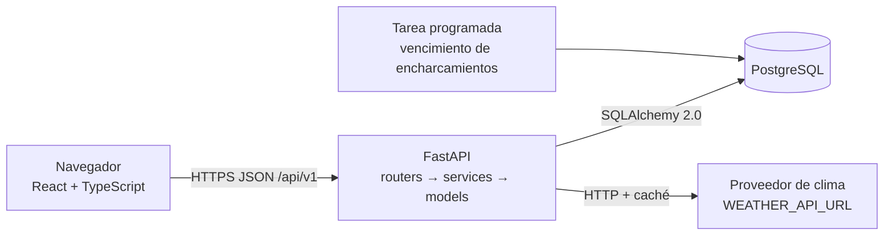
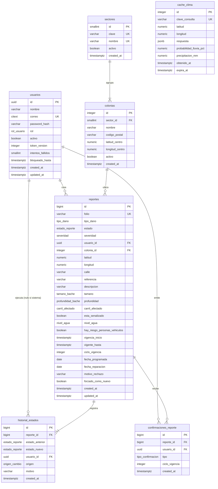
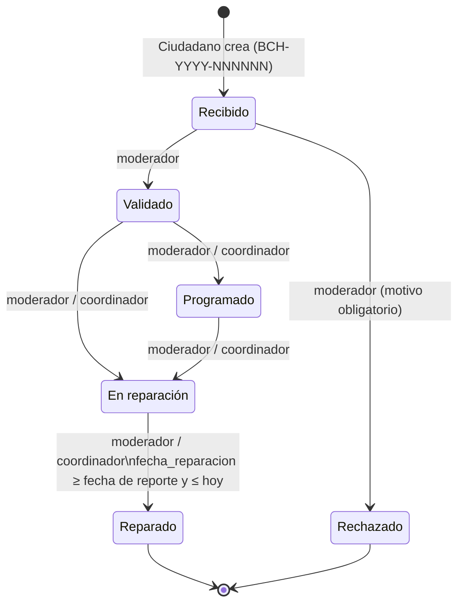
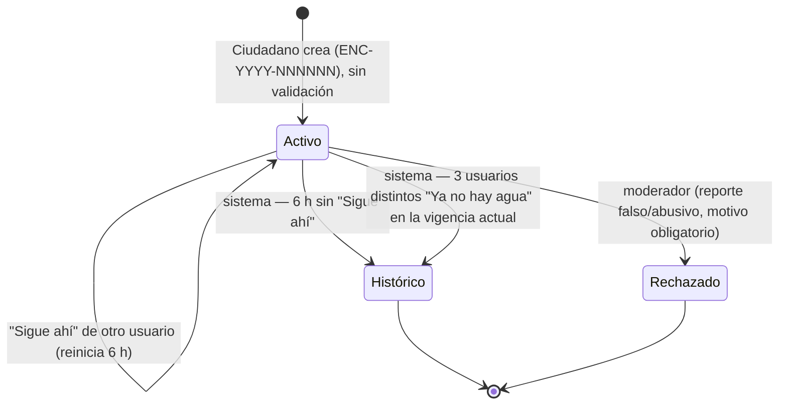

# Arquitectura — Calles Seguras Juárez (AEB-1055)

> Documento de diseño de datos, reglas de negocio y control de acceso.
> Fuente normativa: [`CLAUDE.md`](../CLAUDE.md) (`RN-01` a `RN-10`, `HU-02.2`, `HU-02.3`, `HU-03.1` a `HU-03.3`).
> Contrato HTTP: [`docs/api-contract.md`](./api-contract.md).

---

## 1. Vista general



| Capa | Responsabilidad |
|------|-----------------|
| `routers/` | Declaración de rutas, dependencias de autenticación/rol (`403`), traducción de errores a español. Sin lógica de negocio. |
| `schemas/` | Modelos Pydantic v2 con `extra="forbid"`; esquemas **públicos** y **privados** separados (ver §6). |
| `services/` | Reglas de negocio: territorio, duplicados (Haversine), máquina de estados, vigencia, límite anti-abuso, folios. |
| `models/` | Modelos SQLAlchemy 2.0 (`Mapped[...]`), reflejo 1:1 de este documento. |
| `db/` | Migraciones Alembic (tablas, enums, `CHECK`, índices, triggers) y script `seed`. |

**Defensa en profundidad:** cada regla de negocio crítica se valida en `services/` **y** se respalda en la base de datos con `CHECK`, `UNIQUE`, llaves foráneas o triggers, para que un error de código no pueda violarla.

---

## 2. Diagrama Entidad-Relación



---

## 3. Tipos enumerados (PostgreSQL `ENUM`)

Los valores son **exactamente** los de `CLAUDE.md` y se usan tal cual en la API (JSON) y en la interfaz.

| Enum | Valores |
|------|---------|
| `rol_usuario` | `ciudadano`, `moderador`, `coordinador` *(el `visitante` no se almacena: es la ausencia de token)* |
| `tipo_dano` | `Bache`, `Alcantarilla sin tapa`, `Encharcamiento` |
| `estado_reporte` | `Recibido`, `Validado`, `Programado`, `En reparación`, `Reparado`, `Rechazado`, `Activo`, `Histórico` |
| `severidad` | `Baja`, `Media`, `Alta` |
| `tamano_bache` | `chico`, `mediano`, `grande` |
| `profundidad_bache` | `menos de 5 cm`, `5 a 10 cm`, `más de 10 cm` |
| `carril_afectado` | `carril derecho`, `carril central`, `carril izquierdo`, `varios carriles`, `acotamiento` |
| `nivel_agua` | `a un lado de la calle`, `cubre un carril`, `a media llanta`, `intransitable` |
| `tipo_confirmacion` | `confirmacion_dano` *(baches/alcantarillas: "Yo también lo vi")*, `sigue_ahi` *("Sigue ahí")*, `ya_no_hay_agua` *("Ya no hay agua")* |
| `origen_cambio` | `ciudadano`, `moderacion`, `sistema` |

---

## 4. Diccionario de datos

Convenciones globales:

- Todas las marcas de tiempo son `TIMESTAMPTZ`, almacenadas en **UTC** (`ALTER DATABASE ... SET timezone = 'UTC'`). Ver `RN-02`.
- Coordenadas en `NUMERIC(9,6)` (precisión ≈ 0.11 m).
- Llaves foráneas con `ON DELETE RESTRICT` salvo que se indique lo contrario.
- Extensiones requeridas: `citext` (correo sin distinción de mayúsculas), `pg_trgm` (búsqueda por texto).

### 4.1 `usuarios`

| Columna | Tipo | Nulo | Default | Restricciones / notas |
|---------|------|------|---------|-----------------------|
| `id` | `UUID` | No | `gen_random_uuid()` | PK. UUID para impedir enumeración de cuentas. |
| `nombre` | `VARCHAR(120)` | No | — | `CHECK (char_length(trim(nombre)) >= 2)`. **Dato personal (RN-04).** |
| `correo` | `CITEXT` | No | — | `UNIQUE`. **Dato personal (RN-04).** |
| `password_hash` | `VARCHAR(255)` | No | — | Hash Argon2id. Nunca se serializa en ninguna respuesta. |
| `rol` | `rol_usuario` | No | `'ciudadano'` | Rol único por usuario. El registro público siempre crea `ciudadano`. |
| `activo` | `BOOLEAN` | No | `TRUE` | Cuentas desactivadas reciben `401` al iniciar sesión. |
| `token_version` | `INTEGER` | No | `0` | Se incrementa al cerrar sesión, cambiar rol o desactivar; invalida JWT anteriores (claim `ver`). |
| `intentos_fallidos` | `SMALLINT` | No | `0` | Contador para bloqueo temporal por fuerza bruta. |
| `bloqueado_hasta` | `TIMESTAMPTZ` | Sí | `NULL` | Si `> now()`, el inicio de sesión responde `429`. |
| `created_at` | `TIMESTAMPTZ` | No | `now()` | |
| `updated_at` | `TIMESTAMPTZ` | No | `now()` | Actualizado por trigger. |

Índices: `UNIQUE (correo)`; `idx_usuarios_rol (rol)`.

### 4.2 `sectores`

| Columna | Tipo | Nulo | Default | Restricciones / notas |
|---------|------|------|---------|-----------------------|
| `id` | `SMALLINT` | No | identity | PK. |
| `clave` | `VARCHAR(20)` | No | — | `UNIQUE`, `CHECK (clave ~ '^[A-Z0-9-]{2,20}$')`. Ej.: `SUR-ORIENTE`. |
| `nombre` | `VARCHAR(80)` | No | — | `UNIQUE`. Ej.: `Suroriente`. |
| `activo` | `BOOLEAN` | No | `TRUE` | Los catálogos no se borran; se desactivan. |
| `created_at` | `TIMESTAMPTZ` | No | `now()` | |

### 4.3 `colonias`

| Columna | Tipo | Nulo | Default | Restricciones / notas |
|---------|------|------|---------|-----------------------|
| `id` | `INTEGER` | No | identity | PK. |
| `sector_id` | `SMALLINT` | No | — | FK → `sectores.id`. |
| `nombre` | `VARCHAR(120)` | No | — | `UNIQUE (sector_id, nombre)`. |
| `codigo_postal` | `VARCHAR(5)` | Sí | — | `CHECK (codigo_postal ~ '^32[0-9]{3}$')` (CP de Juárez inician en 32). |
| `latitud_centro` | `NUMERIC(9,6)` | No | — | `CHECK (latitud_centro BETWEEN 31.45 AND 31.80)` — **RN-01**. |
| `longitud_centro` | `NUMERIC(9,6)` | No | — | `CHECK (longitud_centro BETWEEN -106.65 AND -106.25)` — **RN-01**. |
| `activo` | `BOOLEAN` | No | `TRUE` | |
| `created_at` | `TIMESTAMPTZ` | No | `now()` | |

Índices: `idx_colonias_sector (sector_id)`; `idx_colonias_nombre_trgm GIN (nombre gin_trgm_ops)` para autocompletado.

### 4.4 `reportes`

Tabla única para los tres tipos de daño (herencia de tabla única). Los campos específicos son nulables y su obligatoriedad se garantiza con `CHECK` por `tipo_dano`. Esto simplifica la búsqueda de duplicados, las métricas y la consulta pública.

| Columna | Tipo | Nulo | Default | Restricciones / notas |
|---------|------|------|---------|-----------------------|
| `id` | `BIGINT` | No | identity | PK interna. **No se expone en la API**; el identificador público es `folio`. |
| `folio` | `VARCHAR(15)` | No | Generado por servidor | `UNIQUE`. Formato `BCH-YYYY-NNNNNN` o `ENC-YYYY-NNNNNN`. Inmutable (trigger). **RN-03**. |
| `tipo_dano` | `tipo_dano` | No | — | Inmutable (trigger). |
| `estado` | `estado_reporte` | No | — | `Recibido` para pavimento; `Activo` para encharcamiento. |
| `severidad` | `severidad` | No | — | Calculada por backend (§5.4). Nunca la envía el cliente. |
| `usuario_id` | `UUID` | No | — | FK → `usuarios.id`. Autor. **Nunca se expone públicamente (RN-04).** |
| `colonia_id` | `INTEGER` | No | — | FK → `colonias.id`. |
| `latitud` | `NUMERIC(9,6)` | No | — | `CHECK (latitud BETWEEN 31.45 AND 31.80)` — **RN-01**. |
| `longitud` | `NUMERIC(9,6)` | No | — | `CHECK (longitud BETWEEN -106.65 AND -106.25)` — **RN-01**. |
| `calle` | `VARCHAR(150)` | No | — | Calle principal; base de la consulta de "calles con riesgo". |
| `referencia` | `VARCHAR(200)` | Sí | — | Entre calles / punto de referencia. |
| `descripcion` | `VARCHAR(500)` | Sí | — | `CHECK (char_length(descripcion) <= 500)`. |
| `tamano` | `tamano_bache` | Sí | — | Obligatorio si `tipo_dano = 'Bache'` (**HU-02.2**). |
| `profundidad` | `profundidad_bache` | Sí | — | Obligatorio si `tipo_dano = 'Bache'`. |
| `carril_afectado` | `carril_afectado` | Sí | — | Obligatorio si `tipo_dano = 'Bache'`. |
| `esta_senalizado` | `BOOLEAN` | Sí | — | Obligatorio si `tipo_dano = 'Alcantarilla sin tapa'`. |
| `nivel_agua` | `nivel_agua` | Sí | — | Obligatorio si `tipo_dano = 'Encharcamiento'` (**HU-03.1**). |
| `hay_riesgo_personas_vehiculos` | `BOOLEAN` | Sí | — | Obligatorio **sólo** si `nivel_agua = 'intransitable'`. |
| `vigencia_inicio` | `TIMESTAMPTZ` | Sí | — | Inicio de la vigencia actual (creación o último "Sigue ahí"). Sólo encharcamientos. |
| `vigente_hasta` | `TIMESTAMPTZ` | Sí | — | `vigencia_inicio + 6 h`. Sólo encharcamientos. **RN-06**. |
| `ciclo_vigencia` | `INTEGER` | No | `0` | Se incrementa con cada "Sigue ahí"; delimita la "vigencia actual". |
| `fecha_programada` | `DATE` | Sí | — | Fecha local estimada de reparación (estado `Programado`). |
| `fecha_reparacion` | `DATE` | Sí | — | Fecha local (`America/Ciudad_Juarez`) de reparación. **RN-05 / RN-10**. |
| `motivo_rechazo` | `VARCHAR(500)` | Sí | — | Obligatorio si `estado = 'Rechazado'`. **RN-07**. |
| `forzado_como_nuevo` | `BOOLEAN` | No | `FALSE` | `TRUE` si el ciudadano ignoró duplicados cercanos (auditoría de **HU-02.3**). |
| `created_at` | `TIMESTAMPTZ` | No | `now()` | **Inmutable para todos los roles** (trigger). **RN-10**. |
| `updated_at` | `TIMESTAMPTZ` | No | `now()` | |

**Restricciones `CHECK` de tabla:**

```sql
-- Campos específicos por tipo (HU-02.2 / HU-03.1)
CONSTRAINT ck_campos_bache CHECK (
  tipo_dano <> 'Bache' OR (tamano IS NOT NULL AND profundidad IS NOT NULL AND carril_afectado IS NOT NULL
                           AND esta_senalizado IS NULL AND nivel_agua IS NULL AND hay_riesgo_personas_vehiculos IS NULL)),
CONSTRAINT ck_campos_alcantarilla CHECK (
  tipo_dano <> 'Alcantarilla sin tapa' OR (esta_senalizado IS NOT NULL AND severidad = 'Alta'
                           AND tamano IS NULL AND profundidad IS NULL AND carril_afectado IS NULL
                           AND nivel_agua IS NULL AND hay_riesgo_personas_vehiculos IS NULL)),
CONSTRAINT ck_campos_encharcamiento CHECK (
  tipo_dano <> 'Encharcamiento' OR (nivel_agua IS NOT NULL
                           AND (nivel_agua = 'intransitable') = (hay_riesgo_personas_vehiculos IS NOT NULL)
                           AND vigencia_inicio IS NOT NULL AND vigente_hasta IS NOT NULL
                           AND tamano IS NULL AND profundidad IS NULL AND carril_afectado IS NULL AND esta_senalizado IS NULL)),

-- Estados válidos por familia (RN-05 / RN-06)
CONSTRAINT ck_estado_por_tipo CHECK (
  (tipo_dano IN ('Bache','Alcantarilla sin tapa') AND estado IN ('Recibido','Validado','Programado','En reparación','Reparado','Rechazado'))
  OR (tipo_dano = 'Encharcamiento' AND estado IN ('Activo','Histórico','Rechazado'))),

-- Folio coherente con el tipo (RN-03)
CONSTRAINT ck_folio_formato CHECK (
  (tipo_dano IN ('Bache','Alcantarilla sin tapa') AND folio ~ '^BCH-[0-9]{4}-[0-9]{6}$')
  OR (tipo_dano = 'Encharcamiento' AND folio ~ '^ENC-[0-9]{4}-[0-9]{6}$')),

-- Reparación (RN-05 / RN-10)
CONSTRAINT ck_reparado_con_fecha CHECK ((estado = 'Reparado') = (fecha_reparacion IS NOT NULL)),
CONSTRAINT ck_fecha_reparacion_posterior CHECK (
  fecha_reparacion IS NULL OR fecha_reparacion >= (created_at AT TIME ZONE 'America/Ciudad_Juarez')::date),

-- Rechazo con motivo (RN-07)
CONSTRAINT ck_rechazo_con_motivo CHECK (
  estado <> 'Rechazado' OR (motivo_rechazo IS NOT NULL AND char_length(trim(motivo_rechazo)) >= 10)),

-- Vigencia de 6 h (RN-06)
CONSTRAINT ck_vigencia_6h CHECK (vigente_hasta IS NULL OR vigente_hasta = vigencia_inicio + INTERVAL '6 hours')
```

**Índices:**

| Índice | Definición | Propósito |
|--------|------------|-----------|
| `uq_reportes_folio` | `UNIQUE (folio)` | RN-03. |
| `idx_reportes_pav_abiertos_coord` | `BTREE (tipo_dano, latitud, longitud) WHERE estado IN ('Recibido','Validado','Programado','En reparación')` | Prefiltro por caja envolvente para duplicados a ≤ 30 m (HU-02.3). |
| `idx_reportes_enc_activos_coord` | `BTREE (latitud, longitud) WHERE tipo_dano = 'Encharcamiento' AND estado = 'Activo'` | Prefiltro para duplicados a ≤ 50 m (HU-03.1) y mapa de vigentes. |
| `idx_reportes_enc_vencimiento` | `BTREE (vigente_hasta) WHERE estado = 'Activo'` | Tarea de vencimiento (RN-06). |
| `idx_reportes_usuario_created` | `BTREE (usuario_id, created_at DESC)` | Límite de 10 reportes/hora (RN-08) y "Mis reportes". |
| `idx_reportes_estado_created` | `BTREE (estado, created_at DESC)` | Cola de moderación y listados públicos. |
| `idx_reportes_colonia` | `BTREE (colonia_id)` | Filtros e indicadores por colonia/sector. |
| `idx_reportes_calle_trgm` | `GIN (calle gin_trgm_ops)` | Búsqueda de calles con riesgo de inundación. |

**Triggers:**

| Trigger | Momento | Efecto |
|---------|---------|--------|
| `trg_reportes_inmutables` | `BEFORE UPDATE` | Lanza excepción si cambian `folio`, `tipo_dano`, `usuario_id`, `created_at`, `latitud`, `longitud`. RN-03, RN-10. |
| `trg_reportes_transicion` | `BEFORE UPDATE OF estado` | Valida el par (`OLD.estado`, `NEW.estado`) contra la tabla de transiciones (§7) y `fecha_reparacion <= fecha local actual`. Respaldo de RN-05. |
| `trg_reportes_historial` | `AFTER INSERT OR UPDATE OF estado` | Inserta en `historial_estados` con `usuario_id`, `origen` y `motivo` leídos de `current_setting('app.usuario_id' / 'app.origen' / 'app.motivo')` fijados con `SET LOCAL` por el servicio. Garantiza que **ningún** cambio de estado quede sin registrar. RN-07. |
| `trg_reportes_sin_borrado` | `BEFORE DELETE` | Lanza excepción siempre. RN-07 (ver §5.7). |

### 4.5 `historial_estados`

Bitácora **append-only**.

| Columna | Tipo | Nulo | Default | Restricciones / notas |
|---------|------|------|---------|-----------------------|
| `id` | `BIGINT` | No | identity | PK. |
| `reporte_id` | `BIGINT` | No | — | FK → `reportes.id` `ON DELETE RESTRICT`. |
| `estado_anterior` | `estado_reporte` | Sí | — | `NULL` en el registro de creación. |
| `estado_nuevo` | `estado_reporte` | No | — | `CHECK (estado_anterior IS DISTINCT FROM estado_nuevo)`. |
| `usuario_id` | `UUID` | Sí | — | FK → `usuarios.id`. `NULL` sólo si `origen = 'sistema'`. **No se expone públicamente.** |
| `origen` | `origen_cambio` | No | — | `CHECK ((origen = 'sistema') = (usuario_id IS NULL))`. |
| `motivo` | `VARCHAR(500)` | Sí | — | Obligatorio cuando `estado_nuevo = 'Rechazado'` (`CHECK`). |
| `created_at` | `TIMESTAMPTZ` | No | `now()` | Para vencimientos automáticos se registra el instante real de vencimiento (`vigente_hasta`), no la hora en que corrió la tarea. |

Índices: `idx_historial_reporte (reporte_id, created_at)`.

Inmutabilidad: trigger `trg_historial_append_only` (`BEFORE UPDATE OR DELETE` → excepción) **y** `REVOKE UPDATE, DELETE, TRUNCATE ON historial_estados FROM <rol_app>`.

### 4.6 `confirmaciones_reporte`

| Columna | Tipo | Nulo | Default | Restricciones / notas |
|---------|------|------|---------|-----------------------|
| `id` | `BIGINT` | No | identity | PK. |
| `reporte_id` | `BIGINT` | No | — | FK → `reportes.id`. |
| `usuario_id` | `UUID` | No | — | FK → `usuarios.id`. **No se expone públicamente.** |
| `tipo` | `tipo_confirmacion` | No | — | `confirmacion_dano` sólo para pavimento; `sigue_ahi` / `ya_no_hay_agua` sólo para encharcamiento (trigger). |
| `ciclo_vigencia` | `INTEGER` | No | — | Copia de `reportes.ciclo_vigencia` al momento de confirmar (siempre `0` en pavimento). |
| `created_at` | `TIMESTAMPTZ` | No | `now()` | |

Restricciones:

- `UNIQUE (reporte_id, usuario_id, ciclo_vigencia)` → **una confirmación por usuario** por reporte de pavimento y por vigencia en encharcamientos.
- Trigger `trg_confirmacion_valida` (`BEFORE INSERT`): rechaza si `NEW.usuario_id = reportes.usuario_id` (el autor no confirma ni desmiente su propio reporte), si el reporte no está abierto/`Activo`, o si el `tipo` no corresponde al `tipo_dano`.
- Append-only (mismo esquema de trigger + `REVOKE` que el historial).

Índices: `idx_confirmaciones_reporte_ciclo (reporte_id, ciclo_vigencia, tipo)` para contar "Ya no hay agua" de la vigencia actual.

### 4.7 `cache_clima`

| Columna | Tipo | Nulo | Default | Restricciones / notas |
|---------|------|------|---------|-----------------------|
| `id` | `INTEGER` | No | identity | PK. |
| `clave_consulta` | `VARCHAR(60)` | No | — | `UNIQUE`. Ej.: `pronostico:juarez`. |
| `latitud` | `NUMERIC(9,6)` | No | — | Dentro de RN-01. |
| `longitud` | `NUMERIC(9,6)` | No | — | Dentro de RN-01. |
| `respuesta` | `JSONB` | No | — | Respuesta normalizada del proveedor (sin encabezados ni llaves de API). |
| `probabilidad_lluvia_pct` | `NUMERIC(5,2)` | Sí | — | `CHECK (BETWEEN 0 AND 100)`. |
| `precipitacion_mm` | `NUMERIC(6,2)` | Sí | — | `CHECK (>= 0)`. |
| `obtenido_at` | `TIMESTAMPTZ` | No | `now()` | |
| `expira_at` | `TIMESTAMPTZ` | No | — | `obtenido_at + WEATHER_CACHE_TTL_MINUTES`. `CHECK (expira_at > obtenido_at)`. |

Estrategia: *upsert* por `clave_consulta`. Si el proveedor falla y existe caché vencida, se sirve marcada como `desactualizado: true`; si no hay caché, `503`.

---

## 5. Cómo el esquema garantiza las reglas de negocio

| Regla | Servicio (`services/`) | Base de datos |
|-------|------------------------|---------------|
| **RN-01 Territorio** | Validador Pydantic de `latitud`/`longitud` → `422` con mensaje *"La ubicación está fuera de los límites de Ciudad Juárez, Chihuahua."* | `CHECK` de rango en `reportes`, `colonias` y `cache_clima`. |
| **RN-02 Hora oficial** | Toda serialización convierte a `ZoneInfo("America/Ciudad_Juarez")` (offset `-07:00` invierno / `-06:00` verano). Cálculos de "hoy", longevidad y fecha de reparación usan la fecha **local**. | `TIMESTAMPTZ` + sesión en `UTC`. `ck_fecha_reparacion_posterior` compara en zona local. La imagen Docker debe incluir `tzdata ≥ 2022g` (la zona `America/Ciudad_Juarez` se creó en esa versión). |
| **RN-03 Folios** | Generados sólo por el servidor; el cliente no puede enviarlos (`extra="forbid"`). | Dos secuencias independientes `seq_folio_bch` y `seq_folio_enc` (`NO CYCLE`). Las secuencias de PostgreSQL **nunca devuelven un valor dos veces**, aun con *rollback*, por lo que los folios no se reutilizan (puede haber huecos, lo cual es aceptable). `YYYY` = año local de `created_at`; `NNNNNN` = `lpad(nextval, 6, '0')`. `UNIQUE (folio)` + `ck_folio_formato` + trigger de inmutabilidad. |
| **RN-04 Privacidad** | Esquemas `*Publico` sin campos de identidad (§6 y `api-contract.md` §9). | Datos personales sólo en `usuarios`; `reportes` y `confirmaciones` guardan únicamente `usuario_id` (UUID), que nunca se serializa en vistas públicas. |
| **RN-05 Máquina de estados** | `services/transiciones.py` con tabla de transiciones + rol permitido; transición inválida → `400 TRANSICION_INVALIDA`, rol no autorizado → `403`. | `trg_reportes_transicion` + `ck_estado_por_tipo` + `ck_reparado_con_fecha` + `ck_fecha_reparacion_posterior`. |
| **RN-06 Vigencia** | Ver §5.5. | `vigencia_inicio`, `vigente_hasta`, `ciclo_vigencia`, `ck_vigencia_6h`, `UNIQUE` por ciclo, `idx_reportes_enc_vencimiento`. |
| **RN-07 Trazabilidad** | No existe endpoint `DELETE` de reportes (la ruta responde `405`). Rechazo exige `motivo` (≥ 10 caracteres). | `trg_reportes_sin_borrado`, `ck_rechazo_con_motivo`, `trg_reportes_historial`, `historial_estados` append-only + `REVOKE`. |
| **RN-08 Anti-abuso** | En la misma transacción: `pg_advisory_xact_lock(hashtext(usuario_id))` → `SELECT count(*) FROM reportes WHERE usuario_id = :u AND created_at > now() - INTERVAL '1 hour'`; si `>= 10` → `429` con encabezado `Retry-After`. El candado evita que solicitudes concurrentes superen el límite. Aplica a **todas** las cuentas (cualquier rol). | `idx_reportes_usuario_created`. |
| **RN-09 Visibilidad** | Consultas públicas siempre filtran `estado <> 'Rechazado'`; el esquema público agrega `etiqueta_publica = 'Sin validar'` cuando `estado = 'Recibido'`. Un folio `Rechazado` consultado públicamente responde `404` (no se revela su existencia). | `idx_reportes_estado_created`. |
| **RN-10 Longevidad** | `longevidad_dias = (fecha_reparacion − fecha_local(created_at))` si `Reparado`; si sigue abierto, `(hoy_local − fecha_local(created_at))`. Para `Rechazado` y encharcamientos es `null`. | `trg_reportes_inmutables` impide modificar `created_at` a cualquier rol, incluido `coordinador`. |

### 5.1 Campos específicos por tipo de daño (HU-02.2 / HU-03.1)

| `tipo_dano` | Campos obligatorios | Campos prohibidos | Regla automática |
|-------------|---------------------|-------------------|------------------|
| `Bache` | `tamano`, `profundidad`, `carril_afectado` | `esta_senalizado`, `nivel_agua`, `hay_riesgo_personas_vehiculos` | `severidad` calculada (§5.4). |
| `Alcantarilla sin tapa` | `esta_senalizado` | `tamano`, `profundidad`, `carril_afectado`, `nivel_agua`, `hay_riesgo_personas_vehiculos` | `severidad = 'Alta'` fijada en backend. |
| `Encharcamiento` | `nivel_agua`; `hay_riesgo_personas_vehiculos` **sólo** si `nivel_agua = 'intransitable'` | `tamano`, `profundidad`, `carril_afectado`, `esta_senalizado` | `estado = 'Activo'`, `vigencia_inicio = now()`, `vigente_hasta = now() + 6 h`. |

Implementación en Pydantic: unión discriminada por `tipo_dano` (`Annotated[Union[...], Field(discriminator="tipo_dano")]`) con `extra="forbid"` y `model_validator` para la condición de `intransitable`. `descripcion: str | None = Field(default=None, max_length=500)`.

### 5.2 Duplicados (HU-02.3 / HU-03.1)

1. Prefiltro por caja envolvente con los índices parciales (Juárez ≈ 31.7° N):
   - 30 m → Δlat ≈ `0.00027°`, Δlon ≈ `0.00032°`.
   - 50 m → Δlat ≈ `0.00045°`, Δlon ≈ `0.00053°`.
2. Filtro exacto con la función SQL `IMMUTABLE` `distancia_haversine_m(lat1, lon1, lat2, lon2)` (radio terrestre 6 371 008.8 m), creada en la migración.
3. Candidatos:
   - Pavimento: mismo `tipo_dano`, `estado IN ('Recibido','Validado','Programado','En reparación')`, distancia ≤ 30 m.
   - Encharcamiento: `estado = 'Activo' AND vigente_hasta > now()`, distancia ≤ 50 m.
4. Si hay candidatos y `forzar_nuevo = false` → `409 POSIBLE_DUPLICADO` con la lista (esquema público). El ciudadano puede **confirmar el existente** (`POST /reportes/{folio}/confirmaciones`, 1 por usuario) o reenviar con `forzar_nuevo = true` (se guarda `forzado_como_nuevo = TRUE`).

### 5.3 Confirmaciones

- Pavimento: `tipo = 'confirmacion_dano'`, `ciclo_vigencia = 0` ⇒ `UNIQUE` garantiza una por usuario.
- Encharcamiento: `sigue_ahi` o `ya_no_hay_agua`, una por usuario **por vigencia** (no puede marcar ambas en la misma vigencia).
- El autor nunca puede confirmar ni desmentir su propio reporte (servicio → `400 AUTOCONFIRMACION_NO_PERMITIDA`; trigger como respaldo).

### 5.4 Severidad de baches (calculada en backend)

| Condición (se evalúa en orden) | `severidad` |
|--------------------------------|-------------|
| `tamano = 'grande'` **o** `profundidad = 'más de 10 cm'` | `Alta` |
| `tamano = 'mediano'` **o** `profundidad = '5 a 10 cm'` | `Media` |
| En otro caso | `Baja` |
| `tipo_dano = 'Alcantarilla sin tapa'` | `Alta` (siempre) |
| `tipo_dano = 'Encharcamiento'` | `intransitable` → `Alta`; `a media llanta` → `Media`; resto → `Baja` |

### 5.5 Vigencia automática de encharcamientos (RN-06, HU-03.2, HU-03.3)

```text
Creación:        estado='Activo', ciclo_vigencia=0, vigencia_inicio=now(), vigente_hasta=now()+6h

"Sigue ahí"      (SELECT ... FOR UPDATE sobre el reporte)
  de otro usuario  → ciclo_vigencia += 1
                   → vigencia_inicio = now(), vigente_hasta = now() + 6h
                   → insertar confirmación con el NUEVO ciclo_vigencia
                   (los "Ya no hay agua" del ciclo anterior dejan de contar)

"Ya no hay agua" (SELECT ... FOR UPDATE)
  de otro usuario  → insertar confirmación con ciclo_vigencia actual
                   → si count(DISTINCT usuario_id) del ciclo actual >= 3:
                       estado='Histórico' (origen='sistema', motivo='3 usuarios reportaron que ya no hay agua')

Vencimiento      Tarea cada 5 min (APScheduler en el backend):
                   UPDATE ... SET estado='Histórico' WHERE estado='Activo' AND vigente_hasta <= now()
                   historial.created_at = vigente_hasta, origen='sistema',
                   motivo='Sin confirmaciones durante 6 horas'
```

**Consistencia entre ejecuciones de la tarea:** toda consulta pública de vigentes filtra `estado = 'Activo' AND vigente_hasta > now()`, de modo que un encharcamiento vencido nunca se muestra como vigente aunque la tarea aún no haya corrido. El candado `FOR UPDATE` evita condiciones de carrera entre confirmaciones simultáneas.

Los encharcamientos `Histórico` **siguen contando en métricas** e indicadores de riesgo por calle/colonia.

### 5.6 Historial inmutable

- Toda transición pasa por `trg_reportes_historial`; el servicio no puede "olvidar" registrarla.
- `historial_estados` y `confirmaciones_reporte` son *append-only* a nivel trigger **y** a nivel permisos del rol de aplicación.
- El registro de creación (`estado_anterior = NULL`) se escribe en la misma transacción que el `INSERT` del reporte.

### 5.7 Eliminación de reportes

`RN-07` prohíbe eliminar reportes que salieron de `Recibido`. Por simplicidad y mayor trazabilidad, **la versión 1 no permite eliminar ningún reporte**: no existe endpoint `DELETE` y `trg_reportes_sin_borrado` bloquea la operación en la base. Un reporte improcedente se lleva a `Rechazado` con motivo.

---

## 6. Separación de esquemas público / privado (RN-04)

| Esquema | Audiencia | Incluye identidad del autor |
|---------|-----------|-----------------------------|
| `ReportePublico`, `ReporteResumenPublico`, `HistorialPublico`, `IndicadorPublico`, `RiesgoCalle` | Cualquiera (sin token) | **No** |
| `MiReporte` | El propio autor | No incluye nombre/correo (ya los conoce); sólo `es_mio: true`. Incluye `motivo_rechazo` de sus propios reportes rechazados. |
| `ReporteModeracion`, `HistorialModeracion` | `moderador`, `coordinador` | Sólo `autor_id` (UUID) y `reportes_autor_ultimas_24h`, para detectar abuso. **Nunca** nombre ni correo. |
| `UsuarioAdmin` | `coordinador` | Sí (`nombre`, `correo`) — vista privada de administración, nunca vinculada a reportes en la misma respuesta. |

Campos **prohibidos** en cualquier respuesta pública: `usuario_id`, `autor_id`, `nombre`, `correo`, `password_hash`, `token_version`, `ip`, `motivo_rechazo` (los rechazados no son públicos). Se verifica con una prueba automatizada que recorre todas las rutas públicas (ver `api-contract.md` §9).

> **Nota:** `descripcion` es texto libre escrito por el ciudadano. El formulario debe advertir *"No escribas datos personales en la descripción"* y el moderador puede rechazar reportes que los contengan.

---

## 7. Máquina de estados

### 7.1 Baches y alcantarillas (`RN-05`)



| Desde | Hacia | Roles permitidos | Requisitos |
|-------|-------|------------------|------------|
| `Recibido` | `Validado` | `moderador` | — |
| `Recibido` | `Rechazado` | `moderador` | `motivo` ≥ 10 caracteres |
| `Validado` | `Programado` | `moderador`, `coordinador` | `fecha_programada` opcional (≥ hoy local) |
| `Validado` | `En reparación` | `moderador`, `coordinador` | — |
| `Programado` | `En reparación` | `moderador`, `coordinador` | — |
| `En reparación` | `Reparado` | `moderador`, `coordinador` | `fecha_reparacion` ≥ fecha local de `created_at` y ≤ hoy local |
| `Reparado`, `Rechazado` | *(cualquiera)* | — | Estados finales → `400 TRANSICION_INVALIDA` |

Cualquier par no listado → `400 TRANSICION_INVALIDA`. Par válido pero rol no autorizado (p. ej. `coordinador` intentando `Recibido → Validado`) → `403 ROL_NO_AUTORIZADO`. Datos faltantes o fuera de rango (fecha) → `422`.

### 7.2 Encharcamientos (`RN-06`)



> La transición `Activo → Rechazado` no está descrita explícitamente en `CLAUDE.md`; se incluye para que la moderación pueda retirar reportes falsos de la vista pública sin violar `RN-07` (no se elimina, se rechaza con motivo). `Histórico` y `Rechazado` son finales.

---

## 8. Matriz de control de acceso

Los roles **no son estrictamente jerárquicos** (p. ej. `coordinador` no valida reportes). La autorización se aplica en FastAPI con dependencias `requiere_rol(...)`; un rol sin permiso recibe `403`, y la ausencia/expiración de token, `401`.

| Acción | `visitante` | `ciudadano` | `moderador` | `coordinador` |
|--------|:-----------:|:-----------:|:-----------:|:-------------:|
| Registrarse / iniciar sesión | ✅ | — | — | — |
| Ver mapa y lista pública de reportes (sin `Rechazado`, `Recibido` como "Sin validar") | ✅ | ✅ | ✅ | ✅ |
| Ver detalle e historial público de un folio | ✅ | ✅ | ✅ | ✅ |
| Consultar catálogos (sectores, colonias, tipos de daño, estados) | ✅ | ✅ | ✅ | ✅ |
| Consultar clima y calles con riesgo de inundación | ✅ | ✅ | ✅ | ✅ |
| Ver indicadores públicos | ✅ | ✅ | ✅ | ✅ |
| Crear reporte (máx. 10/hora, RN-08) | ❌ 401 | ✅ | ✅ | ✅ |
| Buscar duplicados cercanos | ❌ 401 | ✅ | ✅ | ✅ |
| Confirmar / "Sigue ahí" / "Ya no hay agua" (no sobre reporte propio) | ❌ 401 | ✅ | ✅ | ✅ |
| Ver "Mis reportes" | ❌ 401 | ✅ | ✅ | ✅ |
| Cola de moderación (incluye `Rechazado`, `autor_id`) | ❌ 401 | ❌ 403 | ✅ | ✅ |
| `Recibido → Validado` / `Recibido → Rechazado` | ❌ 401 | ❌ 403 | ✅ | ❌ 403 |
| `Activo → Rechazado` (encharcamiento) | ❌ 401 | ❌ 403 | ✅ | ❌ 403 |
| `Validado → Programado / En reparación`, `Programado → En reparación`, `En reparación → Reparado` | ❌ 401 | ❌ 403 | ✅ | ✅ |
| Indicadores de moderación | ❌ 401 | ❌ 403 | ✅ | ✅ |
| Administrar usuarios (rol, activar/desactivar) | ❌ 401 | ❌ 403 | ❌ 403 | ✅ |
| Administrar sectores y colonias | ❌ 401 | ❌ 403 | ❌ 403 | ✅ |
| Eliminar reportes | ❌ | ❌ | ❌ | ❌ (`405`, RN-07) |
| Modificar `created_at`, `folio`, ubicación o autor de un reporte | ❌ | ❌ | ❌ | ❌ (RN-03, RN-10) |

---

## 9. Seguridad (OWASP Top 10:2025)

| Riesgo | Control |
|--------|---------|
| A01 Control de acceso roto | Dependencias de rol por ruta (`403`), folios como identificador público, `id` interno nunca expuesto, UUID para usuarios, esquemas públicos sin PII, `extra="forbid"` contra asignación masiva (no se puede enviar `rol`, `estado`, `severidad`, `folio`). |
| A02 Configuración insegura | CORS restringido a `FRONTEND_URL`; `/docs` y `/openapi.json` deshabilitados cuando `APP_ENV=production`; encabezados de seguridad en el servidor del frontend. |
| A03 Cadena de suministro | Dependencias con versiones fijas (`requirements.txt` con hashes, `package-lock.json`), imágenes base oficiales con etiqueta fija. |
| A04 Fallas criptográficas | Argon2id para contraseñas; `JWT_SECRET_KEY` ≥ 32 bytes aleatorios desde entorno; el backend no arranca si conserva el valor de ejemplo en producción. |
| A05 Inyección | SQLAlchemy con parámetros enlazados; sin SQL concatenado; validación Pydantic estricta. |
| A06 Diseño inseguro | Límite de 10 reportes/hora (RN-08), bloqueo tras 5 intentos fallidos de inicio de sesión en 15 min, reglas de negocio replicadas en la base de datos. |
| A07 Fallas de autenticación | JWT de 30 min con renovación por actividad (expira tras 30 min de inactividad), `token_version` para revocación, mensajes de error de login genéricos. |
| A08 Integridad de datos | Historial append-only, triggers de inmutabilidad, folios del servidor. |
| A09 Registro y alertas | Bitácora de transiciones, intentos de acceso `401/403/429` registrados **sin** contraseñas, tokens ni correos completos. |
| A10 Manejo de condiciones excepcionales | Manejador global de excepciones que devuelve errores genéricos en español sin trazas; caída del proveedor de clima degradada a caché (`desactualizado: true`) o `503`. |
